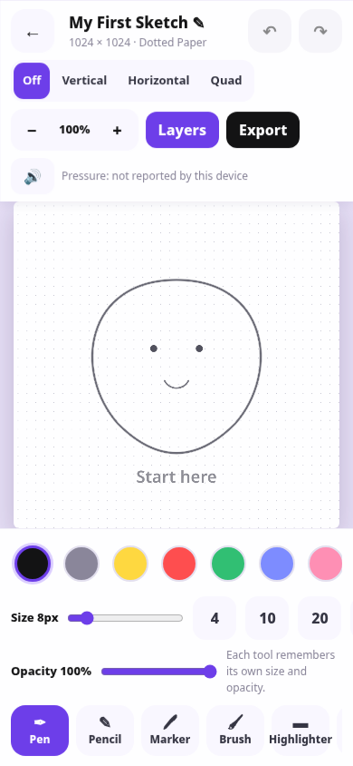

# Art and Design — A real drawing canvas

Art and Design is a real drawing app prototype with a proper canvas: smoothed strokes whose width responds to pressure and speed, zoom and pan from 50 to 300 percent, and autosave with a Saving and Saved state.

## What it does

- Pen, pencil, marker, brush, highlighter, eraser, fill, shapes, text, stickers, a colour picker, and symmetry drawing, with up to four true layers per artwork. Each tool remembers its own colour, size, and opacity.
- Papers, colouring templates, a reference photo panel with a trace mode, and an idea generator for when the page is blank.
- A gallery with folders, search and favourites, and a Trash with 30-day auto-empty.
- PNG and JPG export at true canvas size.
- Seeded with exactly one artwork, "My First Sketch".

## Status

Working prototype, built November 2026.

## Showcase only

This repository is a showcase. It contains no source code and no build files, and nothing here is open source. The screenshot(s) above are showcase images only. See NOTICE.md.

## Contact

Built by Yash Dashrath, Pune, India.

- Email: yashdashrath18@gmail.com
- LinkedIn: https://www.linkedin.com/in/yash-dashrath
- Yash MediaWorks: https://www.linkedin.com/company/yashmediaworks/
